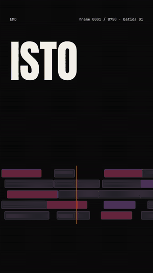
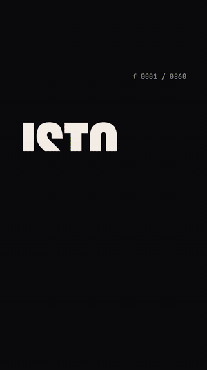
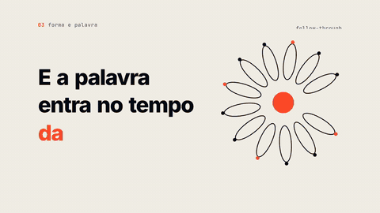
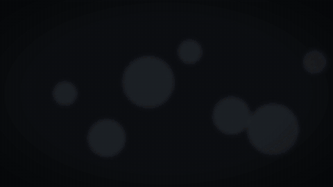

# Extreme Motion Design

Skill de motion design para agentes de código (Claude, Claude Code, Codex e qualquer agente que leia `SKILL.md`). O agente escreve o vídeo em código com Remotion e React, com voz, trilha licenciada e efeitos sonoros sincronizados, e só pode entregar depois que os frames foram medidos.

[Read in English](README.md)

<p align="center">
  
</p>

O filme acima é a apresentação da 2.0, feito com a skill. Todo número na tela foi medido e as imagens são de domínio público ou CC0 (NASA, USGS, NPS e The Met), buscadas pela skill com a licença conferida arquivo a arquivo.

## O que há de novo na 2.0

- **Modo referência.** Entregue um vídeo e o `reference.py` desmonta em estrutura medida (planos, movimento de câmera, paleta, onde está a massa visual, áudio), escreve o esqueleto do roteiro com os mesmos tempos e dá uma nota de 0 a 100 à peça nova contra a referência. Calibração: a peça contra ela mesma dá 100, com as fronteiras da partitura como cortes 86, um reel feito do mesmo pedido sem a referência 38, vídeos sem relação 23 e 24. Ele copia estrutura, ritmo e técnica. Nunca copia frame, asset, texto ou som.
- **Um medidor de design.** O `design.py` conta os sinais do quadro que um modelo faz sem direção: quase preto com um acento, condensada gigante na margem esquerda, mono de enfeite, tudo em caixa alta, a mesma composição em toda cena. Ele acusou o meu próprio reel da 1.3 (4 sinais) e o exemplo do template (3). O filme da 2.0 dá 0.
- **Uma referência de design.** `references/design.md` cobre composição, tipografia, cor, textura, imagem real e estrutura de filme de lançamento, cada regra com a origem, e seis direções de arte nomeadas para propor.
- **Imagem real com a licença conferida.** O `stock.py` busca foto e vídeo no Wikimedia Commons (só CC0 e domínio público), na NASA, no Openverse e no Met, e registra a evidência lida na API para cada arquivo.
- **Rastreio de rosto e de mão** no `track.py`, para gráfico preso ao corpo.

## Por que ela existe

Um agente que escreve vídeo em código não enxerga o que renderiza. Sozinho ele entrega texto cortado pela borda, legenda em cima do rosto, o mesmo cartão deslizando em toda cena e áudio estourado. Montei a skill em volta desse ponto cego:

- **O áudio é o relógio.** Um `roteiro.json` gera a voz frase a frase, a partitura e as marcas nomeadas. Cena nenhuma guarda número de frame escrito à mão.
- **A direção é um contrato.** Antes de existir cena, a peça declara conceito, lei visual, motivo e o layout e a entrada de cada cena. O lint reprova o projeto sem isso e reprova quando todas as cenas têm a mesma composição.
- **O texto é medido, não olhado.** Uma sonda lê do DOM a caixa de cada texto de cada still e lê o fundo nos pixels. Cortado, sobreposto, pequeno, sem contraste ou fora da área segura reprova.
- **Outro revisa.** A folha de contato vai para um revisor de contexto limpo, que nunca viu o código.
- **O arquivo final passa por um gate numérico.** Codec, loudness, true peak, flashes por segundo, pop de 1 frame, emenda de loop e contraste contra os stills.

## O que os gates pegaram na produção deste reel e de um segundo, feito sobre filmagem de celular

São linhas reais da sessão, não exemplos escritos para o README.

| Gate | O que disse | O que estava errado |
|---|---|---|
| `layout.py` | `"renderizando 90%" x "milho": dois textos sobrepostos` | Uma etiqueta caiu em cima da legenda |
| `layout.py` | `letra de 9 px: mínimo legível é 20 px neste formato` | Uma ficha foi capturada crescendo a partir do zero |
| `layout.py` | `"Extreme": texto cortado pela borda do quadro` | Um título de 300 px saiu pela direita |
| `layout.py` | `"Cor,": contraste 2.9:1 (texto #ff4b1f sobre #f3eee5)` | Laranja sobre papel creme |
| `qa.py` | `true peak: -0.1 dBTP (máx -1.0)` | O AAC subiu os picos de uma voz muito amplificada |
| `qa.py` | `flashes por segundo <= 3: pior janela: 4` | Um estouro de cinco cores piscava |
| revisor | "FAIL vira PASS com o mesmo valor medido" | A cena do checklist se contradizia |
| revisor | "EDIÇAO está sem til" | A máscara de entrada cortava acento em fonte condensada |

Tudo foi consertado antes da entrega, e quatro desses achados viraram correção na própria skill.

## O mesmo pedido sem a skill

Rodei o mesmo pedido no mesmo modelo com a skill proibida, só Remotion puro, e sem voz paga. É a comparação honesta, então aqui está ela com o que eu medi.

<p align="center">
  
  
</p>

| | Sem a skill | Com a skill |
|---|---|---|
| Tempo até o arquivo | cerca de 8 minutos, 1 render | várias vezes mais, 1 render completo e 1 remendo de cena |
| Visual | forte, e parecido com o da direita | forte |
| Voz | nenhuma | narração com tempo real por palavra, e os cortes seguem a fala |
| Trilha | sintetizador cru de ffmpeg, que o próprio agente apontou como o ponto mais fraco | faixa CC BY com crédito registrado, abaixada sob a voz |
| Loudness | -12,5 LUFS, reprova no alvo de -14 | -14, true peak abaixo de -1 dBTP |
| Marca de cor | nenhuma | BT.709 |
| Texto e área segura | título cortado pela borda direita no meio da cena, leitura de frame em y 118, embaixo da interface do app | medido em todo still, 0 reprovações na entrega |
| Números na tela | "frame 105" no checklist é inventado | o contador mostra o frame real e o checklist mostra medidas reais |
| Revisão independente | nenhuma | 16 de 21 quadros devolvidos como FIX; os defeitos reais foram consertados, os que eram meio de transição não |

O que eu tiro disso: um modelo bom já faz um quadro bonito sem ajuda. A skill não compra bom gosto. Ela compra som, relógio, texto medido, número verdadeiro e um segundo par de olhos, e custa tempo.

## Galeria

| | Pedido | Notas |
|---|---|---|
|  | "Quero algo em todas as dimensões e estilos, alternando entre mundo real e não, uma edição digna de cinema, tipografias modernas, voz animada." | Voz ElevenLabs (`eleven_v4`), 11 cenas, 68 s, imagens de domínio público e CC0, veredito do `design.py`: direção própria, 0 sinais. A trilha foi composta na ElevenLabs Music por um script fora da skill, porque o `music.py` não tem essa fonte. 4 renders completos e 1 remendo de cena |
|  | "Um reel 9:16 bem extravagante, de uns 25 s, apresentando a skill como manifesto: isto não é edição, é código." | Voz ElevenLabs, cortes na batida de uma faixa CC BY, cena 3D, contador de frames real. [Código](examples/reel-manifesto). 1 render completo e 1 remendo de cena |
|  | "Apresente a própria skill em 90 s, técnica por técnica." | Feito com a versão 1.1, 11 cenas |
|  | nenhum | O exemplo que vem no template, gerado pelo `score.py` com a voz local |

## Instalação

### Claude Code (plugin)

```
/plugin marketplace add dev-isaacmello/extreme-motion-design
/plugin install extreme-motion-design@extreme-motion-design
```

### Claude Code, Codex, Cursor e outros (skills CLI)

```bash
npx skills add dev-isaacmello/extreme-motion-design
```

### Claude (claude.ai e app desktop)

```bash
git clone https://github.com/dev-isaacmello/extreme-motion-design
cd extreme-motion-design/skills
zip -r extreme-motion-design.zip extreme-motion-design/
```

Envie o zip em **Customize > Skills**. O zip precisa ter a pasta `extreme-motion-design/` no topo.

### Atualização

- Plugin: `claude plugin update extreme-motion-design@extreme-motion-design` e reinicie.
- skills CLI: rode `npx skills add` de novo.
- claude.ai: remova a skill antiga e envie o zip novo.

## Uso

Peça em linguagem natural.

```
crie um vídeo de 20 segundos, 16:9, com narração suave em pt-BR, apresentando o lançamento do plano anual
```

```
um reel 9:16 a partir deste vídeo de celular, com a legenda seguindo a minha mão
```

```
anime este logo em 4 segundos e feche em loop sem emenda
```

## Como um vídeo é feito

| Etapa | O que acontece |
|---|---|
| Brief | Objetivo, público, formato, duração, tom e marca em cinco linhas |
| Marca | `brand.py` extrai cores, fontes e logo de um site, de um repositório ou de screenshots, com a origem de cada valor. Nada é inventado: o que não foi achado fica vazio |
| Voz | `voice.py` mede o hardware e o agente pergunta: sem voz, ElevenLabs ou modelo local que cabe na máquina |
| Direção | Duas ou três direções como styleframes, o usuário escolhe e a escolha vai para `direction.json` |
| Partitura | `score.py` transforma o `roteiro.json` em voz, `timeline.json` e `cues.json`. Cada frase fica guardada pelo hash: mexer em pausa ou corte não custa nada e trocar uma frase regera só aquela |
| Trilha e SFX | `music.py` busca faixa com licença verificada ou gera uma localmente. `sfx.py` sintetiza os efeitos. `mix.py` abaixa a trilha sob a voz |
| Cenas | 15 blocos prontos (gráficos, contador, moldura de aparelho, legenda, janela de código, cursor, lower third e outros) e primitivas de câmera, morph, rig, tipografia cinética e tracking |
| Lint | `lint.py` confere o contrato de direção, a partitura e o código em menos de um segundo |
| Dailies | `stills.cjs` renderiza os frames-chave em um processo só, `layout.py` mede o texto e `contact_sheet.py` monta a folha |
| Revisão | Um subagente de contexto limpo reconta a mensagem só pelos frames e marca PASS ou FIX em cada quadro |
| Render | `render.cjs` renderiza cena por cena, remenda uma cena sem render completo e entrega reels, quadrado e paisagem da mesma composição |
| Gate | `qa.py` no arquivo final. Sem FAIL, ou não há entrega |

Técnicas cobertas: keyframing, easing e springs, movimentos de câmera e parallax, tipografia cinética, morphing, loop sem emenda, microinterações de UI, antecipação, overshoot, squash e stretch, smear, speed ramp, match cut, transição por forma e líquida, mattes, frame a frame, cel animation, stop motion, rigging com IK, lip sync, 3D, compositing, rastreio de ponto, de plano, de rosto e de mão, match moving e rotoscopia.

## Requisitos

- Node 18 ou mais novo.
- Python 3.10 ou mais novo. Os scripts declaram as dependências no próprio cabeçalho (PEP 723) e rodam com `uv run`.
- ffmpeg no PATH.

## Licença do Remotion

A skill é MIT. O Remotion, que renderiza o vídeo, tem código disponível e não é open source. Leia antes de adotar a skill no trabalho:

- Gratuito para indivíduos, para empresas de até 3 funcionários, para organizações sem fins lucrativos e para avaliação.
- A partir de 4 pessoas é preciso a Company License. Quando conferi (2026-10-13) o assento custava US$ 25 por mês, e cada pessoa que escreve código Remotion precisa de um, inclusive por meio de agente de código.
- Freelancer ou agência que entrega só o arquivo final conta o próprio número de pessoas. Se o cliente opera o projeto, os números somam.
- O rascunho dos termos do Remotion 5.0 diz que terceirizados passam a contar no tamanho do time. O 5.0 não tinha sido lançado quando conferi.

Fontes: [LICENSE.md](https://github.com/remotion-dev/remotion/blob/main/LICENSE.md), [FAQ da licença](https://www.remotion.dev/docs/license/faq), [preços](https://www.remotion.pro/license). A skill avisa o usuário quando a empresa tem mais de 3 pessoas.

## O que a skill executa e acessa

- `npm install` no projeto do vídeo (Remotion, React e Three do registro do npm).
- `uv run` nos scripts de `scripts/`, que instala as dependências Python declaradas em cada arquivo.
- `voice.py` lê threads, RAM, disco e GPU (`nvidia-smi`). Com `--check-key` faz uma leitura em `api.elevenlabs.io`.
- `score.py` e `tts.py` enviam o roteiro para a ElevenLabs só quando essa voz foi escolhida, com a chave do `.env` do projeto. `score.py --dry` mostra antes a contagem de caracteres e a execução paga exige `--yes`.
- `tts.py` baixa o modelo de voz Kokoro (cerca de 330 MB) e `align.py` baixa o Whisper `small` (cerca de 460 MB) no primeiro uso.
- `track.py --face` baixa o YuNet (230 KB) e `--hand` baixa o modelo de mão do MediaPipe (7,5 MB). `roto.py --backend rembg` baixa o modelo de segmentação dele.
- `music.py` consulta Incompetech e Openverse.
- `stock.py` consulta o Wikimedia Commons, o acervo de imagens da NASA, o Openverse e o Met, e o Pixabay só quando você põe uma chave no `.env`. Baixa o arquivo escolhido e tira a faixa de áudio dos vídeos.
- `reference.py` só lê o arquivo de vídeo que você entrega. Não baixa de nenhuma plataforma.
- `brand.py --url` busca a página indicada e as folhas de estilo, fontes e imagens que ela referencia, e tira dois screenshots com um Chrome headless local. `--repo` só lê arquivos.
- Nenhum outro endereço é acessado.

## Limites

- O agente revisa frames parados e números. Ritmo e sensação de movimento continuam precisando de um olho humano antes de publicar.
- A sonda de layout só enxerga texto do DOM. Texto desenhado em canvas, em WebGL ou dentro de imagem não é medido, e texto coberto por outra camada opaca é medido como se estivesse visível.
- A semelhança entre cenas compara miniaturas em cinza de 24x24. Foi calibrada em seis vídeos (medianas de -0,08 a 0,71) e eu não tinha um vídeo repetitivo para calibrar o limiar do aviso, então ele é conservador.
- A nota de fidelidade mede estrutura, não qualidade nem conteúdo, e a leitura de andamento erra quando há voz sobre a trilha.
- Os limiares do medidor de design vêm de prática e foram calibrados em poucos vídeos. O veredito é aviso, não gate.
- Licença livre cobre só o direito autoral. Pessoa reconhecível, marca e obra recente continuam exigindo autorização, e o `stock.py` não detecta isso.
- `brand.py` escolhe o acento por heurística. Em marca monocromática pode errar ou sair vazio, e ele avisa.
- O rastreio de rosto falha em perfil e em rosto olhando para baixo. O de mão perde gesto rápido.
- `render.cjs --scene` só sabe o que você disse que mudou. Depois de mexer em código compartilhado, renderize tudo.
- Os avisos de ritmo do `qa.py` e do `lint.py` são heurística ajustada em poucos vídeos.
- Só o Kokoro está integrado como voz local. Os outros modelos de `assets/tts-models.json` são recomendação por licença e memória.
- As instruções da skill estão em português.

## Licença

MIT
